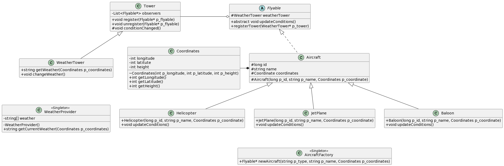
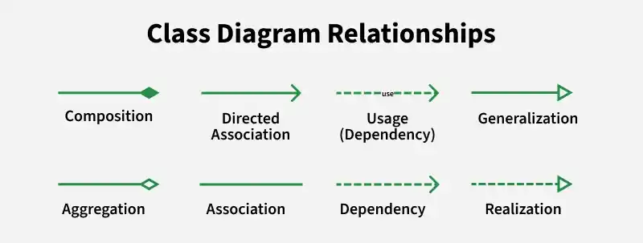

This project has been created as part of the 42 curriculum by xwu.

# Avaj-Launcher

Avaj-Launcher is a simulation program based on a simplified aircraft management system. It uses object-oriented programming, inheritance, interfaces, and the Observer design pattern to simulate aircraft reacting to changing weather conditions.

## Overview

The program reads a scenario file containing aircraft definitions and a simulation duration. It then creates the corresponding aircraft, registers them with a weather tower, and runs the simulation turn by turn.

During each iteration:

- The weather changes according to the aircraft's geographical position.
  - As how weather changes was left under my discretion, I decided to add the coordinates and take the modulo 4.
- Aircraft react to the current weather conditions.
- Their altitude and coordinates are updated.
- Aircraft that reach height 0 land and unregister from the weather tower. If height started as 0, it unregisters before any action.
- Every event is recorded in `simulation.txt`.

## Features

- Object-oriented architecture using inheritance and polymorphism, following a UML diagram


**Visibility guide**
  * `+` public
  * `-` private
  * `#` protected
  * `~` package or default visibility

**Relationship guide**

  

- Observer design pattern for communication between aircraft and the weather tower.
- Multiple aircraft types:
  - **Baloon**
  - **JetPlane**
  - **Helicopter**
- Dynamic weather generation based on geographical coordinates.
- Aircraft-specific reactions to weather conditions.
- Simulation logging and automatic aircraft registration/unregistration.

## Project Structure

```text
.
├── src/
│   └── avaj/
│       ├── Main.java
│       ├── Aircraft.java
│       ├── Baloon.java
│       ├── JetPlane.java
│       ├── Helicopter.java
│       └── ...
├── Makefile
├── scenario.txt
└── README.md
```

## Requirements

- Java Development Kit (JDK).
- Make.

## Compilation

Clone the repository:

```bash
git clone https://github.com/seeyouwhoosh/avaj-launcher.git
cd avaj-launcher
```

Compile the project:

```bash
make compile
```

## Usage

Run the simulation by providing a scenario file, or if you don't specify, it will use "scenario.txt":

```bash
SCENARIO="myscenario.txt"
make run
```

The scenario file defines the number of simulation iterations and the aircraft that will participate.

### Scenario format

```text
NUMBER_OF_ITERATIONS
AIRCRAFT_TYPE NAME LONGITUDE LATITUDE HEIGHT
AIRCRAFT_TYPE NAME LONGITUDE LATITUDE HEIGHT
...
```

Example:

```text
5
Baloon B1 2 3 20
JetPlane J1 4 5 50
Helicopter H1 6 7 10
```

### Output

The simulation generates a `simulation.txt` file containing a chronological log of events, including:

- Aircraft registration.
- Weather changes.
- Aircraft reactions.
- Position updates.
- Aircraft landing and unregistration.

## Concepts

This project explores several fundamental object-oriented programming concepts:

| Concept | Application |
|---|---|
| Inheritance | Shared aircraft behaviour |
| Polymorphism | Aircraft-specific weather reactions |
| Encapsulation | Aircraft state and behaviour |
| Interfaces | Common contracts between classes |
| Observer Pattern | Weather tower notifications |
| File I/O | Scenario parsing and simulation logging |
