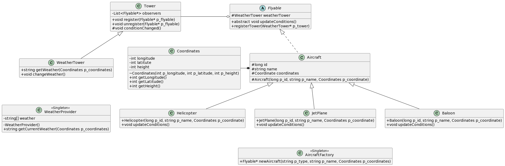
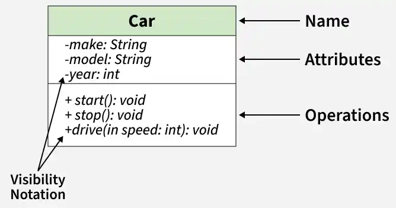
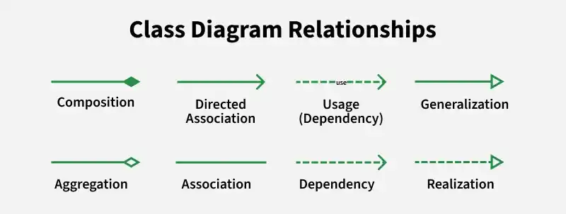

# avaj-launcher
## Unified Modeling Language
Básicamente, una forma de visualizar el diseño de un sistema. El que nos dan en la subject:

### Cajita

### Visibilidad
* `+` public
* `-` private
* `#` protected
* `~` package or default visibility

### Relación

Parte_1 es el coso inicial, Parte_2 es el destino de la línea.

* **Composition**: Parte_1 no puede existir de forma independiente de Parte_2
* **Composition**: No mucha relación. Parte_1 puede existir de forma independiente
* **Generalization** (Inheritance): Parte_1 es un hijo de Parte_2
* **Realization** (Interface Implementation): Lo mismo que Generalization, pero Parte_2 es una interface

## Otros conceptos
* Java package **naming conventions**:
  * Reverse domain naming convention 
  * Packages in the Java language itself begin with java. or javax.

